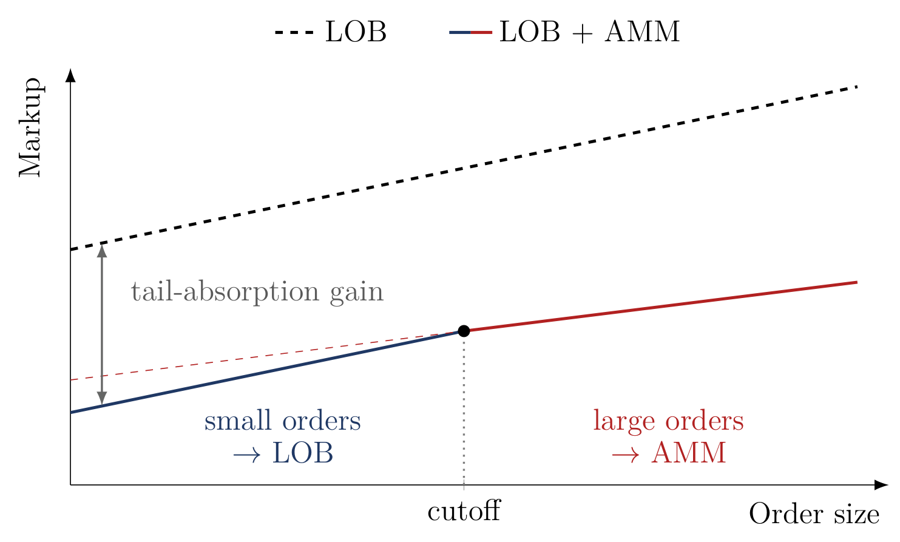

I am on the 2026–2027 academic job market.

I am a PhD candidate in Finance at the [Vienna Graduate School of Finance (VGSF)](https://www.vgsf.ac.at/), supervised by [Nikolaus Hautsch](https://homepage.univie.ac.at/nikolaus.hautsch/). In fall 2026, I was a visiting PhD student at the Haskayne School of Business, University of Calgary, hosted by [Alfred Lehar](https://profiles.ucalgary.ca/alfred-lehar). My research areas are market microstructure, market design, and decentralized finance (DeFi).

  <h2>Job Market Paper</h2>
  

    Job Market Paper
    <h3 class="jmp-title">Absorbing the Tail: How Automated Market Makers Affect Limit Order Book Liquidity</h3>
    
Single-authored

    

      
The coexistence of an automated market maker (AMM) with a limit order book (LOB) that trades the same asset raises depth at the top of the book. In a model of competitive liquidity supply, the AMM's fixed pricing function lets its liquidity providers (LPs) break even on average over the orders they serve, while LPs on the LOB break even on the marginal unit at each price. When the AMM has a cost advantage over the LOB, it offers better execution than the LOB for orders above a size cutoff and absorbs the largest orders, which carry the most information. LPs on the LOB thus face less informed order flow and post more depth at every price they quote. On Uniswap v3 and Binance, the AMM's share of orders rises with order size, reaching about 86% in the largest size bin on ETH–USDC. The launch of PancakeSwap v3, an AMM on Binance's blockchain, raised depth at Binance's best bid and ask by about 57% relative to Coinbase's, and the gain shrinks farther down the book, as the model predicts.

      

        <figure class="jmp-fig">
          
          <figcaption>Small orders execute on the order book, large orders on the AMM. With the tail absorbed, the order book charges a lower markup at every size. Adapted from Figure 8 of the paper.</figcaption>
        </figure>
      

    

  

  <h2>Working Papers</h2>
  

    
The DeFi Dilemma

    
with <a href="https://homepage.univie.ac.at/nikolaus.hautsch/">Nikolaus Hautsch</a> and <a href="https://voigtstefan.me">Stefan Voigt</a>

    

      
Abstract

      
Blockchains let decentralized finance (DeFi) settle transactions without trusted intermediaries through two building blocks: pre-trade transparency of pending transactions and transaction-fee-based priority. We show that these features expose rent-generating transactions to front-running risk, deterring the transactions on which market efficiency depends. Using block-level data on cross-DEX arbitrage across Uniswap V2 and Sushiswap from December 2020 to November 2024, we find that the atomic arbitrage transaction submitted to the public mempool realizes at most 7% of the profit available net of transaction fees. The price differences nonetheless close within a block or two, through dark pools and trades hedged on other venues. When the randomly drawn validator of the next block cannot include dark pool transactions, they stay open one block longer. Overcoming these inefficiencies requires reintroducing centralized intermediation, which undermines the foundational premise of DeFi.

    

  

  <h2>Work in Progress</h2>
  

    
What Drives Stablecoin Yields in DeFi Lending Markets?

    
with Yuan Chen and Min Yang

  

  <h2>References</h2>
  

    
<b>Nikolaus Hautsch</b> (Supervisor) University of Vienna <a href="mailto:nikolaus.hautsch@univie.ac.at">nikolaus.hautsch@univie.ac.at</a>

    
<b>Alfred Lehar</b> Haskayne School of Business, University of Calgary <a href="mailto:alehar@ucalgary.ca">alehar@ucalgary.ca</a>

    
<b>Stefan Voigt</b> University of Copenhagen <a href="mailto:stefan.voigt@econ.ku.dk">stefan.voigt@econ.ku.dk</a>

    
<b>Christian Westheide</b> Stockholm Business School, Stockholm University <a href="mailto:christian.westheide@sbs.su.se">christian.westheide@sbs.su.se</a>

  

